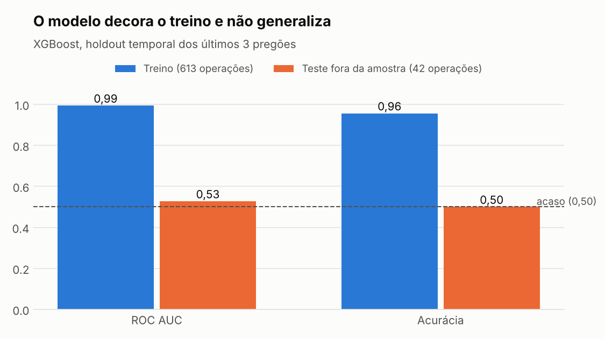
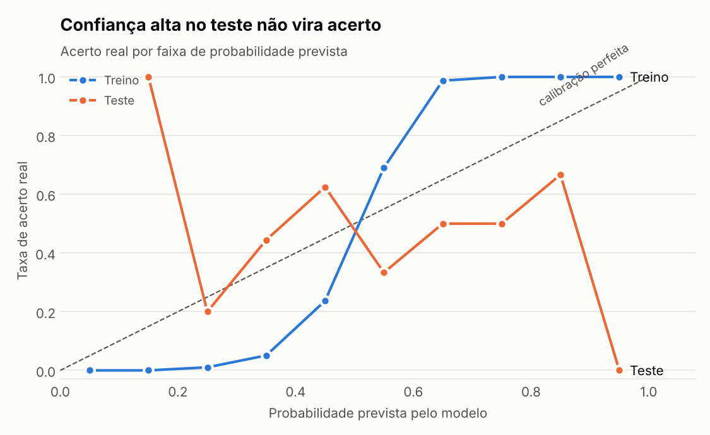
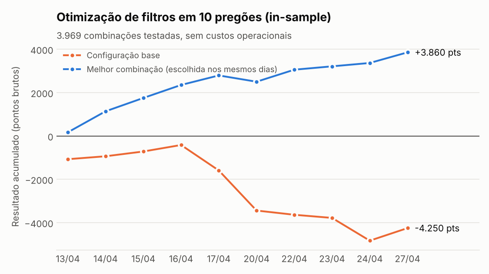

# Lara — sistema de machine learning para mini índice (WIN/B3)

Sistema de trading algorítmico em Python que opera o contrato de mini índice futuro (WIN) via MetaTrader 5, com um modelo XGBoost decidindo as entradas. O projeto cobre o ciclo completo: coleta de dados ao vivo, geração de dataset, treino com holdout temporal, execução com travas de segurança, simulação *shadow* e uma bateria de auditorias para detectar vazamento de dados e overfitting.

> **Status:** projeto de pesquisa pessoal, rodando em modo simulação (sem ordens reais). O resultado principal até agora é um diagnóstico: **o modelo atual não generaliza**, e as auditorias mostram por quê. Detalhes em [Resultados](#resultados).

*English summary: ML trading system for Brazilian mini-index futures (B3) built in Python with XGBoost and MetaTrader 5. Includes live execution with safety locks, shadow simulation, temporal holdout training and a leakage/overfitting audit suite. The current model overfits (train AUC 0.99 vs test 0.53); the audits document why.*

---

## Destaques técnicos

- **Pipeline ponta a ponta:** indicadores em tempo real → features → inferência → decisão → ordem → reconciliação → logs auditáveis → retreino.
- **Validação temporal honesta:** split cronológico por pregão (sem embaralhar), checado por auditoria automática de interseção de dias, duplicatas e *drift* (PSI).
- **Auditorias de overfitting:** gap treino/teste, calibração por faixa de probabilidade, poder preditivo de cada feature isolada, vizinho mais próximo entre teste e treino, composição por lado e regime de mercado.
- **Segurança operacional:** ordem real só sai com `simulacao: false` **e** `permitir_execucao_real: true`; checagem de idade e AUC mínima do modelo antes de usar; `order_check` antes de cada envio; zeragem automática no fim do dia.
- **Operação autônoma:** supervisor que inicia no pregão, encerra, deduplica logs, roda checagens de fim de dia e hiberna até o próximo dia útil; troca automática do contrato vigente (WIN).
- **Backtest de filtros:** 3.969 combinações de limiares, cooldown e janelas de horário avaliadas sobre logs reais.

## Arquitetura

```
              ┌──────────────────────── lara/ (sistema operacional) ────────────────────────┐
              │                                                                              │
 MetaTrader 5 │  supervisor.py ──► run_lara.py ──► motor_lara.py                              │
   (cotações, │      │                               │  indicadores (EMA, ATR, volatilidade)  │
    ordens)◄──┼──────┼───────────────────────────────┤  modelo XGBoost → probabilidade        │
              │      │                               │  limiares + filtros → ordem / bloqueio │
              │      │                               └──► arquivo_ABC/ (logs CSV do dia)      │
              │      ▼                                                                       │
              │  fim do dia: eod_logfix.py → simular_shadow.py → prezip_check.py             │
              │  retreino:   pipeline_retreino.py → selecionar_dias_treino.py → treinar_modelo.py
              └──────────────────────────────────────────────────────────────────────────────┘
                                         │ logs e dataset
                                         ▼
              research/auditorias/  (vazamento, overfitting, calibração)
              research/backtest/    (bateria de cenários, otimização, replay de volatilidade)
                                         │
                                         ▼
                                  reports/  ·  docs/img/
```

**Como o sinal é formado.** A cada 15 s o motor calcula tendência (EMA 20 × EMA 100), ATR(14) e volatilidade normalizada (ATR / média de 50). O XGBoost recebe essas features mais as probabilidades direcionais `pc`/`pv` e devolve a probabilidade de a operação atingir o alvo antes do stop (alvo e stop simétricos de 150 pontos). Essa probabilidade vira compra ou venda conforme o regime de tendência e só gera ordem se passar no limiar do lado (compra 0,70 / venda 0,60) e nos filtros de cooldown após perda e bloqueio dos primeiros 30 minutos do pregão.

## Estrutura do repositório

| Caminho | Conteúdo |
|---|---|
| `lara/motor_lara.py` | Motor principal: indicadores, inferência, decisão, execução e reconciliação de ordens |
| `lara/run_lara.py` | Ponto de entrada: valida o config e inicia o loop |
| `lara/supervisor.py` | Orquestra o dia: janela de pregão, fim do dia, hibernação |
| `lara/config_utils.py` | Validação do config e metadados do modelo |
| `lara/treinar_modelo.py` | Treino XGBoost com holdout temporal, relatório e `meta.json` |
| `lara/pipeline_retreino.py` | Seleção de dias válidos + retreino gerando um modelo *candidato* |
| `lara/simular_shadow.py` | Reconstrói as operações que o modelo teria feito, a partir dos logs |
| `lara/eod_logfix.py`, `log_fechamento.py`, `logging_utils.py` | Logs auditáveis e deduplicação |
| `lara/config_lara.json` | Configuração atual (modo simulação) |
| `lara/modelos/modelo_lara4/` | Modelo em uso, relatório de treino e dataset (655 operações, 42 pregões) |
| `research/auditorias/` | Scripts de auditoria do modelo |
| `research/backtest/` | Bateria de cenários, otimização de filtros, replay de volatilidade |
| `reports/` | Saídas das auditorias e resumos dos backtests |

## Resultados

### 1. O modelo decora o treino



No holdout temporal (os 3 últimos pregões do dataset, nunca vistos no treino), a AUC cai de 0,99 para 0,53 e a acurácia fica em 50%. É o padrão clássico de memorização.

### 2. A confiança do modelo não se sustenta fora da amostra



No treino, faixas de probabilidade alta acertam quase 100%. No teste, a curva não acompanha a probabilidade prevista: confiança alta não significa acerto maior. As faixas do teste têm poucas operações, então a curva é ruidosa, mas a ausência de tendência é consistente com as demais auditorias.

### 3. O que as auditorias descartaram e o que encontraram

| Hipótese | Auditoria | Resultado |
|---|---|---|
| Vazamento por dias misturados | `auditar_split_oos.py` | Split cronológico, sem interseção de dias |
| Linhas duplicadas entre treino e teste | `auditar_split_oos.py` | Nenhuma duplicata |
| Features com sinal real | `auditar_features.py` | AUC isolada de cada feature entre 0,52 e 0,55 no teste; duas mudam de sentido entre treino e teste |
| Teste fora da faixa do treino | `auditar_split_oos.py` | 100% do teste dentro da faixa do treino, porém com *drift* de distribuição alto (PSI > 0,25 em todas as features) |

**Leitura:** o problema não é bug de validação. As features atuais carregam pouca informação sobre o resultado da operação, e o XGBoost compensa decorando o treino. Com 655 operações, o modelo tem capacidade de sobra para isso.

### 4. Otimização de filtros: um alerta de *data snooping*



A melhor de 3.969 combinações de filtros transforma −4.250 em +3.860 pontos brutos em 10 pregões. Mas a combinação foi escolhida **nos mesmos 10 dias** em que é avaliada, sem custos de corretagem e emolumentos. Com tantas tentativas, um resultado assim é esperado mesmo sem vantagem real. Por isso essa configuração segue em simulação até ser confirmada em dias novos.

## Próximos passos

1. Validação *walk-forward* com janelas deslizantes e vários holdouts, no lugar de um único holdout de 3 dias.
2. Regularizar o XGBoost (profundidade, `min_child_weight`, *early stopping*) e comparar com uma regressão logística como linha de base.
3. Incluir custos operacionais e *slippage* na simulação.
4. Testar features de microestrutura (fluxo de ordens, volume por agressão) e de contexto (horário, gap de abertura).
5. Confirmar os filtros otimizados fora da amostra antes de qualquer uso real.

## Como rodar

Requer Python 3.10+. A execução ao vivo exige Windows com o terminal MetaTrader 5 aberto e logado (a biblioteca `MetaTrader5` só existe para Windows). Treino, auditorias e gráficos rodam em qualquer sistema.

```bash
pip install -r requirements.txt

# Treinar um modelo candidato (não sobrescreve o modelo em uso)
cd lara
python treinar_modelo.py

# Auditorias do modelo (as saídas vão para reports/auditorias/)
python ../research/auditorias/auditar_split_oos.py
python ../research/auditorias/auditar_memorizacao.py
python ../research/auditorias/auditar_features.py

# Regerar os gráficos deste README
python ../research/gerar_graficos_readme.py

# Execução ao vivo, em modo simulação (Windows + MT5)
python preflight_mt5.py      # checa conexão, símbolo e permissões
python supervisor.py         # roda o dia inteiro de forma autônoma
```

Os backtests em `research/backtest/` leem os logs diários do motor em `lara/arquivo_ABC/`, que não são versionados.

## Stack

Python · pandas · NumPy · scikit-learn · XGBoost · MetaTrader 5 API · matplotlib · Git

## Aviso

Projeto educacional e de pesquisa. Não é recomendação de investimento. Operar derivativos envolve risco de perda superior ao capital investido.

---

**Autor:** Alex Mendonça · [GitHub](https://github.com/AlexPMendonca)
